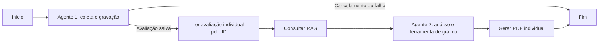

# Comunicação entre agentes com LangGraph

Protótipo pelo terminal, integrado aos códigos atualizados fornecidos no ZIP.
Assim que o agente 1 conclui e salva a coleta no SQLite, o LangGraph passa o ID
salvo ao agente 2 e gera um PDF **individual**, como definido para este protótipo.



O grafo real está em `comunicacao_agentes.py`, usando `StateGraph`, nós e rotas
condicionais do [LangGraph](https://docs.langchain.com/oss/python/langgraph/graph-api).
O estado compartilhado contém o ID e os dados persistidos; não transporta o texto
livre da conversa. O protótipo não usa checkpoints persistentes do LangGraph.

## Instalação

Python 3.10+ para o código. No Windows x64, use **Python 3.14+** para o instalador
local das dependências nativas de PDF.

```powershell
python -m venv .venv
.\.venv\Scripts\python.exe -m pip install -r requirements.txt -r requirements-comunicacao.txt
.\.venv\Scripts\python.exe instalar_bibliotecas_pdf.py
```

O último comando é específico do Windows: instala Pango e dependências oficiais
MSYS2 em `.runtime/`, verificando SHA256, sem alterar o PATH global. Em Linux/macOS,
instale as bibliotecas nativas conforme a [documentação do WeasyPrint](https://doc.courtbouillon.org/weasyprint/stable/first_steps.html#installation).
Em Linux/macOS, use `.venv/bin/python` no lugar de `.\.venv\Scripts\python.exe`.

## Executar a simulação autorizada

No primeiro terminal, inicie a API de gráficos:

```powershell
.\.venv\Scripts\python.exe -m uvicorn api:app --host 127.0.0.1 --port 8000
```

No segundo terminal, na mesma pasta:

```powershell
.\.venv\Scripts\python.exe comunicacao_agentes.py --simulado
```

Esse modo não chama Ollama, não consulta documentos reais e não necessita das
dependências do RAG. Usa 12 notas fixas fictícias, a rotina de finalização do agente 1,
o banco `simulacao/burnout_prototype.db`, a análise artificial identificada e a
API real de gráficos. O PDF é criado em `relatorios/simulacao/` e recebe o aviso
**SIMULAÇÃO DE TESTE**. As notas, respostas artificiais e fontes vazias estão
explícitas em `simulacao_agentes.py`; não representam resultados de pessoas reais.

Uma primeira coleta tem somente uma medição: nesse caso, a API retorna `null`
e o PDF informa histórico insuficiente. Não é criado um segundo ponto fictício
para forçar um gráfico. O gráfico é incorporado quando existe histórico individual
suficiente e a ferramenta é chamada pelo agente 2.

## Executar com os agentes e Ollama reais

Instale também as dependências do RAG fornecido:

```powershell
.\.venv\Scripts\python.exe -m pip install -r requirements-rag.txt
```

O ZIP não contém `Documentos/` nem a base vetorial `BancoDados/`. Para usar o RAG,
forneça seus documentos reais em `Documentos/` e execute:

```powershell
.\.venv\Scripts\python.exe ingestao.py
```

O módulo usa ChromaDB, a coleção `documentos_rag` e embeddings
`intfloat/multilingual-e5-small` em CPU, como nos códigos recebidos. A primeira
execução pode baixar o modelo de embeddings. Não foram criados documentos ou
fontes de referência para preencher uma base ausente.

Com a API de gráficos e o Ollama disponíveis e o modelo já instalado:

```powershell
.\.venv\Scripts\python.exe comunicacao_agentes.py
```

A interação de consentimento, escolha de equipe e coleta usa o agente 1 recebido.
O aviso de consentimento do protótipo informa a geração individual. O modo normal
continua usando Ollama e o RAG fornecido, sem respostas simuladas de fallback.

Configurações existentes dos agentes:

| Variável | Uso |
| --- | --- |
| `LOCAL_MODEL` | Modelo do agente 1 |
| `OLLAMA_URL` | Endereço Ollama do agente 1; padrão `http://localhost:11434` |
| `OLLAMA_MODEL` | Modelo do agente 2 |
| `OLLAMA_HOST` | Endereço usado pelo cliente Ollama do agente 2 |
| `GRAFICOS_API_URL` | API de gráficos; padrão `http://127.0.0.1:8000` |

O modelo padrão dos dois agentes foi mantido:
`hf.co/bartowski/Qwen_Qwen3-8B-GGUF:Q3_K_M`.

## Banco, falhas e retomada

O novo `database.py` inclui `listar_equipes()` e migração idempotente de
`ItensFaltantes`. Foram preservados os parâmetros de equipe usados pelo script
anterior de demonstração. As conexões são fechadas após cada transação.

A gravação da coleta agora é atômica: equipe, usuário, avaliação, itens faltantes
e respostas são confirmados juntos. A sessão só recebe `id_avaliacao` após o
commit. Cancelamento, risco ou falha de gravação impedem o acionamento do agente 2.

A leitura individual usa o ID exato e consulta somente o histórico daquele usuário
até a avaliação selecionada. Não calcula médias da equipe, não acrescenta margens
de erro e não inclui texto livre ou dados de outras pessoas no PDF.

Se RAG, Ollama ou PDF falharem depois da gravação, o fluxo informa a falha e mantém
a avaliação salva. Para retomar sem repetir a coleta, use o ID e o mesmo banco:

```powershell
.\.venv\Scripts\python.exe comunicacao_agentes.py --avaliacao 1 --banco burnout_prototype.db
```

Para retomar uma simulação:

```powershell
.\.venv\Scripts\python.exe comunicacao_agentes.py --simulado --avaliacao 1
```

Também é possível escolher `--banco CAMINHO` e `--saida PASTA`. JSON inválido do
modelo resulta em falha explícita após as tentativas existentes do agente 2;
não é substituído por uma análise inventada. Uma falha apenas da API de gráficos
mantém o comportamento fornecido: o agente 2 pode prosseguir com o PDF sem imagem.

O `agente1.py` e o `criaDoc.py` continuam disponíveis isoladamente. A comunicação
automática e o PDF individual são iniciados por `comunicacao_agentes.py`.

## API de gráficos

- `GET /health` verifica disponibilidade.
- `POST /graficos/evolucao-score` recebe histórico e retorna PNG em Base64.
- Documentação: http://127.0.0.1:8000/docs

```json
{
  "historico": [
    {"data": "2026-10", "score_geral": 2.75},
    {"data": "2026-11", "score_geral": 2.97}
  ],
  "escopo": "individual"
}
```

`escopo` é opcional e mantém `grupo` como padrão para compatibilidade. Scores
válidos estão entre 1 e 5; valores nulos são ignorados. Com menos de duas medições,
`grafico_b64` é `null`. Dados inválidos retornam HTTP 422. A ordem recebida é mantida.

## Testes

```powershell
.\.venv\Scripts\python.exe -m pip install -r requirements-dev.txt
.\.venv\Scripts\python.exe -B -m unittest discover -s tests -v
```

É necessário instalar as bibliotecas nativas de PDF descritas acima. Ollama e
ChromaDB são simulados nos testes; o grafo, SQLite, renderização de gráficos e
PDF são reais. Os testes incluem cancelamento, risco, rollback, falha do agente 2,
retomada sem duplicação, avaliação parcial, separação de pessoas, JSON inválido,
migrações e gráfico incorporado ao PDF. Há também um teste HTTP com Uvicorn real,
que inicia e encerra sua própria API em porta temporária.

As dependências pesadas de RAG são opcionais e não são baixadas na suíte.
O GitHub Actions configura as bibliotecas de PDF e roda os testes em Python
3.10 e 3.14. Bancos, PDFs, ambientes virtuais e DLLs não são versionados.
